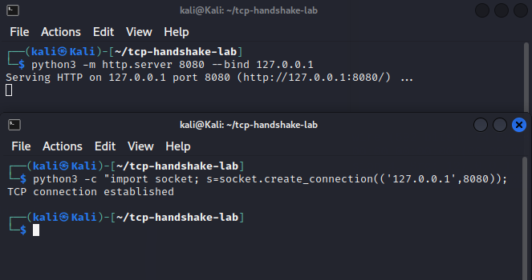
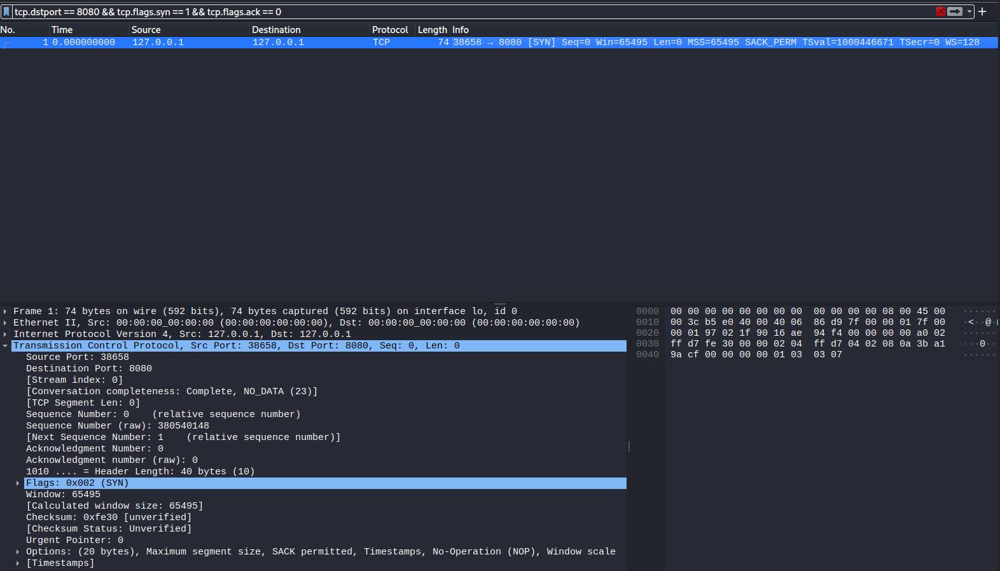
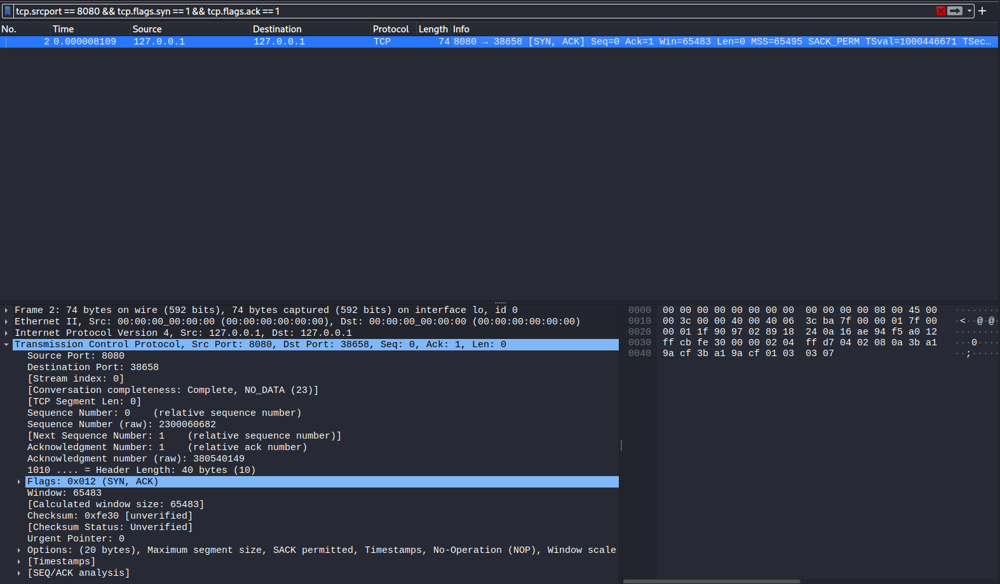
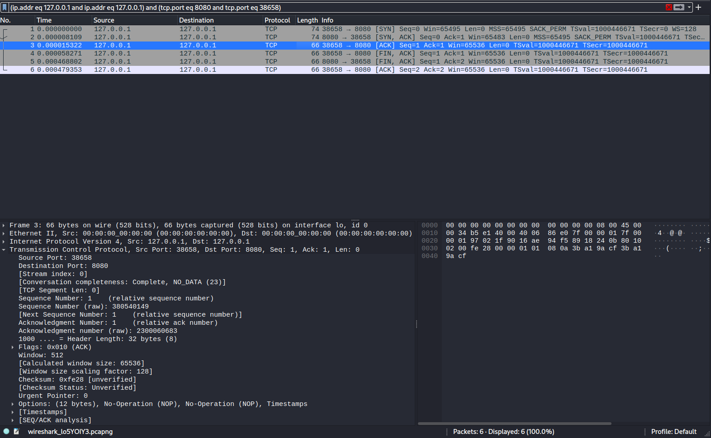

# TCP Three-Way Handshake Analysis Using Wireshark

## 1. Objective

The objective of this project was to observe and analyse the TCP three-way handshake using Python socket and Wireshark.

The experiment focused on identifying SYN, SYN-ACK, and ACK packets and examining TCP flags, port numbers, sequence numbers, and acknowledgement numbers.

## 2. Environment and Tools

The experiment was performed on a single Kali Linux virtual machine.

- Operating System: Kali Linux
- TCP Client: Python socket
- TCP Server: Python HTTP server
- Packet Analysis: Wireshark
- Network Interface: Loopback (lo)
- IP Address: 127.0.0.1
- Server Port: 8080

Both the client and server communicated locally through the loopback interface.

## 3. Methodology

### Step 1: Start the TCP Server

A local HTTP server was started using:

```bash
python3 -m http.server 8080 --bind 127.0.0.1
```

### Step 2: Start Wireshark

Wireshark was launched, and the loopback interface (`lo`) was selected for packet capturing.

The following display filter was applied:

```text
tcp.port == 8080
```

### Step 3: Establish a TCP Connection

A Python socket client was used to establish a TCP connection with the local server.

```bash
python3 -c "import socket; s=socket.create_connection(('127.0.0.1',8080)); print('TCP connection established'); s.close()"
```

The connection triggered the TCP three-way handshake.

### Step 4: Analyse the Packets

Wireshark was used to identify and examine the three handshake packets:

1. SYN: The client initiates the connection.
2. SYN-ACK: The server acknowledges the request.
3. ACK: The client acknowledges the server's response.

TCP flags, ports, sequence numbers, and acknowledgement numbers were examined.

## 4. Results and Findings

### 4.1 TCP Three-Way Handshake

The captured traffic demonstrated the TCP connection establishment process.

| Step | Direction | TCP Flags | Relative Seq | Relative Ack |
|---|---|---|---|---|
| 1 | Client to Server | SYN | 0 | — |
| 2 | Server to Client | SYN, ACK | 0 | 1 |
| 3 | Client to Server | ACK | 1 | 1 |

The server used TCP port 8080, while the client used a dynamically assigned source port.

### 4.2 TCP Flags Analysis

The SYN packet initiated the TCP connection.

The SYN-ACK packet confirmed that the server received the connection request and was prepared to establish the connection.

The final ACK completed the three-way handshake.

### 4.3 Sequence and Acknowledgement Numbers

Wireshark displayed relative TCP sequence and acknowledgement numbers.

The acknowledgement number increased by one when acknowledging a SYN because the SYN flag consumes one sequence number.

The packet analysis demonstrated how TCP uses these values during connection establishment.

### 4.4 Summary

The experiment demonstrated how TCP connections are established through the three-way handshake.

Wireshark provided a clear view of the packet exchange and helped explain how TCP flags and sequence numbers support reliable communication.

## 5. Supporting Evidence

### Laboratory Setup



### SYN Packet



### SYN-ACK Packet



### ACK Packet



### Packet Capture File

[View TCP Packet Capture](evidence/tcp-handshake.pcapng)

## 6. Reflection and Improvements

This project helped me understand the TCP three-way handshake through practical packet analysis.

I learned how to establish a TCP connection using Python socket and identify the SYN, SYN-ACK, and ACK packets using Wireshark.

The experiment also improved my understanding of TCP flags, dynamic source ports, sequence numbers, and acknowledgement numbers.

In future experiments, I would investigate TCP connection termination, retransmissions, and failed connection attempts to gain a more comprehensive understanding of TCP behaviour.

## 7. Ethical Considerations

All network communication was generated locally on a Kali Linux virtual machine using the loopback interface.

No external systems or unauthorised network traffic were involved in the experiment.
